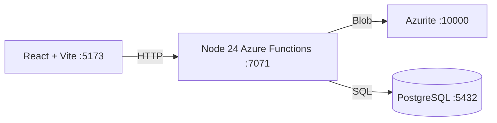

# Azure Debug Plan

> This plan is the source of truth for generating the
> VS Code debug setup in this workspace.
>
> **Status:** Planning
> **Execution Mode:** Guided
> **Created:** 2026-11-04T00:00:00Z
> **Last Updated:** 2026-11-04T00:00:00Z

---

## Development Environment

| Field | Value |
|-------|-------|
| Mode | Sandbox |
| Image | Local Dockerfile based on `mcr.microsoft.com/devcontainers/javascript-node:24-bookworm@sha256:1bc82e3350b0da52ca1a1b1b2e7527300bc6fdfd778287e0eed564203d66a68c` |
| Match Rationale | Every generated application service declares Node.js 24 and the API uses Azure Functions programming model v4. |
| Host Prerequisites | Docker, Docker Compose, Chrome, Azure Functions extension |
| Base-Provided Tools | Node.js 24.22.1, npm 11.19.1, pnpm 12.16.1, Yarn 1.22.22, Git, certificates, build tools, and common developer utilities |
| CoR-Added Tools | Azure CLI 2.91.0, Azure Functions Core Tools 4.16.0, DNS diagnostics, netcat, and PostgreSQL client |
| Supporting Emulators | Azurite and PostgreSQL as separate Compose services |
| Forwarded Ports | 5173 frontend, 7071 Functions HTTP, 9229 Node inspector, 10000-10002 Azurite, 5432 PostgreSQL |
| Workspace Topology | VS Code remains on the host; Compose bind-mounts the workspace, stores Linux dependencies in a container-only named volume, and runs emulators as sibling services. |

---

## Prerequisites

| Tool / Extension | Category | Service(s) | Installed | Version |
|------------------|----------|------------|-----------|---------|
| Docker | Container Runtime | * | ✅ | 27 |
| Docker Compose | Orchestration | * | ✅ | 2 |
| Chrome | Browser | web | ✅ | 140 |
| ms-azuretools.vscode-azurefunctions | VS Code Extension | api | ✅ | 1 |

---

## Debug Configurations

| Generate | Debug Config Name | Service Label | Service Root | Project Type | Runtime | Version | Azure Dependencies |
|----------|-------------------|---------------|--------------|--------------|---------|---------|-------------------|
| [x] | Compliance API (debug) | api | services/api | functions | node-ts | 24.x | Azure Storage, PostgreSQL |
| [x] | Compliance Web (debug) | web | services/web | frontend-spa | node-ts | 24.x | — |
| [x] | Debug All Services | — | — | *Compound Config* | — | — | — |

---

## Orchestrator

| Orchestrator | Container Runtime | Compose Command | Description |
|-------------|-------------------|-----------------|-------------|
| Docker Compose | Docker | `docker compose` | Runs the sandbox and emulators with Docker Compose. |

---

## Emulators

| Dependent Service | Emulator | Purpose |
|-------------------|----------|---------|
| Azure Storage | Azurite Container | Local Blob Storage |
| PostgreSQL | PostgreSQL Container | Local relational database |

---

## Architecture Diagram

