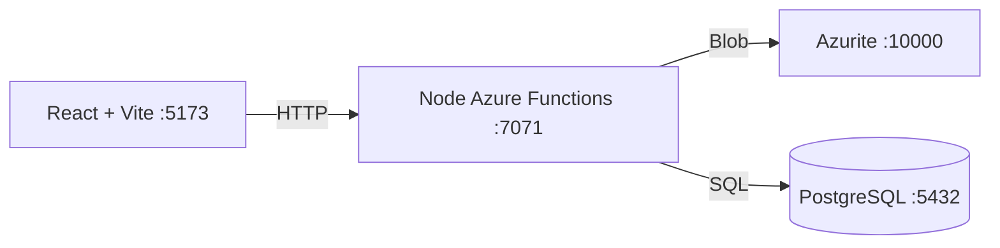

# Azure Debug Plan

> This plan is the source of truth for generating the
> VS Code debug setup in this workspace.
>
> **Status:** Planning
> **Execution Mode:** Guided
> **Created:** 2026-11-04T00:00:00Z
> **Last Updated:** 2026-11-04T00:00:00Z

---

## Prerequisites

> **Development Environment:** Host — application runtimes and CLIs will run directly on this machine.
> Sandbox was not selected because the project has no explicit Node runtime and no valid `.azure/created-by-cor.json` marker.

| Tool / Extension | Category | Service(s) | Installed | Version |
|------------------|----------|------------|-----------|---------|
| Node.js | Runtime | * | ❓ | — |
| npm | Package Manager | * | ❓ | — |
| Azure Functions Core Tools | Runtime | api | ❓ | — |
| Docker | Container Runtime | * | ✅ | 27 |
| Docker Compose | Orchestration | * | ✅ | 2 |
| Chrome | Browser | web | ✅ | 140 |
| ms-azuretools.vscode-azurefunctions | VS Code Extension | api | ✅ | 1 |

> ⚠️ **Action required:** Confirm any tool or extension marked ❓ is installed and ready before approving this plan.

---

## Debug Configurations

| Generate | Debug Config Name | Service Label | Service Root | Project Type | Runtime | Version | Azure Dependencies |
|----------|-------------------|---------------|--------------|--------------|---------|---------|-------------------|
| [x] | Compliance API (debug) | api | services/api | functions | node-ts | Unknown | Azure Storage, PostgreSQL |
| [x] | Compliance Web (debug) | web | services/web | frontend-spa | node-ts | Unknown | — |
| [x] | Debug All Services | — | — | *Compound Config* | — | — | — |

---

## Orchestrator

| Orchestrator | Container Runtime | Compose Command | Description |
|-------------|-------------------|-----------------|-------------|
| Docker Compose | Docker | `docker compose` | Runs supporting emulators while application services run on the host. |

---

## Emulators

| Dependent Service | Emulator | Purpose |
|-------------------|----------|---------|
| Azure Storage | Azurite Container | Local Blob Storage |
| PostgreSQL | PostgreSQL Container | Local relational database |

---

## Architecture Diagram

